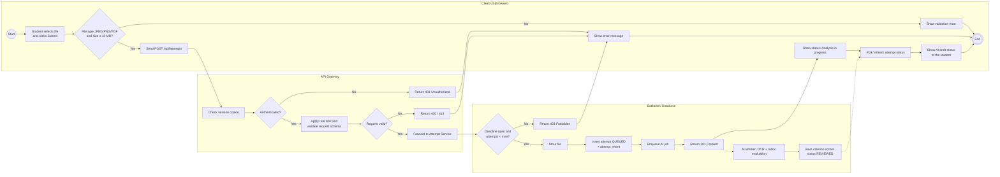

# Activity Diagram — Submit Attempt (with Swimlanes)

Swimlanes: **Client UI** (browser), **API Gateway** (auth, rate limiting, request validation), **Backend / Database** (business rules, persistence, job queue, AI worker).

## Flow Description
1. The student selects a file; the client checks type and size before sending (fast feedback, FR-02).
2. The API Gateway checks the session (401 if missing), applies rate limiting and validates the request (400/413 on error).
3. The backend checks the deadline and attempt limit (403 if violated, FR-07), stores the file, inserts the attempt with status QUEUED and an audit event, and enqueues the AI job.
4. The API returns 201 immediately; the AI worker processes the job asynchronously (dashed arrows) and saves draft scores with status REVIEWED (FR-03, FR-08).