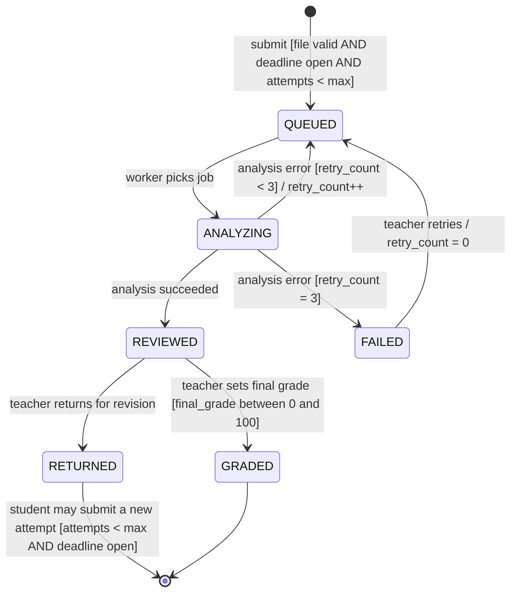
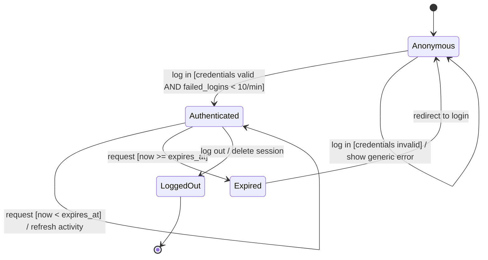

# State Machine Diagrams

Notation: `event [guard] / action`. A transition fires only when its **guard** (condition in square brackets) is true.

## 1. Attempt Lifecycle

| State | Meaning |
|---|---|
| QUEUED | Attempt is stored and waiting for the AI worker |
| ANALYZING | Worker is running OCR and rubric evaluation |
| REVIEWED | AI draft is ready; waiting for the teacher |
| FAILED | Analysis failed 3 times; needs a manual retry |
| RETURNED | Teacher asked for revision; this attempt is closed |
| GRADED | Teacher approved the final grade; terminal state |

Every transition is recorded in `attempt_events` (from_status, to_status, actor, time).

## 2. User Session Lifecycle

The generic error on failed login does not reveal whether the account exists (security requirement).