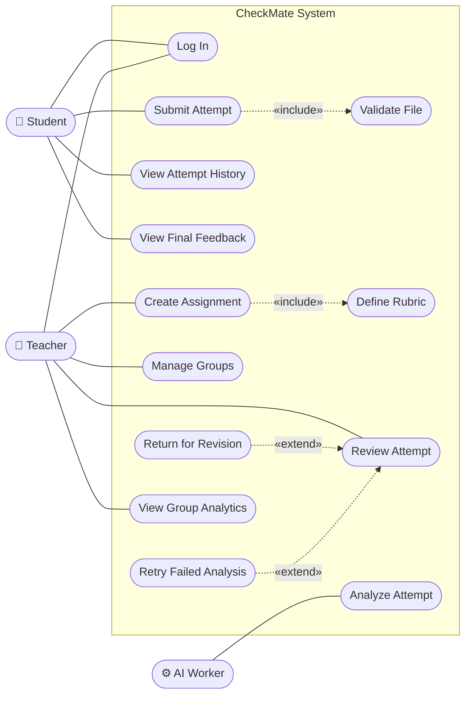

# Use Case Diagram

**Notation:** `«include»` — the base use case always performs the included one (every submission is validated). `«extend»` — the extending use case adds optional behaviour to the base one under a condition (the teacher may return work for revision or retry a failed analysis while reviewing).

## Use Case Specifications

### UC-02: Submit Attempt
| Field | Description |
|---|---|
| Actor | Student |
| Preconditions | Student is logged in; the assignment is PUBLISHED for the student's group |
| Main flow | 1. Student opens the assignment. 2. Student selects a JPEG/PNG/PDF file. 3. System performs **Validate File** «include». 4. System creates the attempt with status QUEUED. 5. System queues the AI analysis job. 6. System shows "Analysis in progress". |
| Alternative flows | 3a. File is larger than 10 MB or of a wrong type → system shows an error, no attempt is created. 3b. Deadline has passed or the attempt limit is reached → system rejects the submission. |
| Postconditions | A new numbered attempt exists and an AI job is queued |
| Related FRs | FR-02, FR-03, FR-04, FR-07 |

### UC-09: Review Attempt
| Field | Description |
|---|---|
| Actor | Teacher |
| Preconditions | Attempt status is REVIEWED (AI draft is ready) |
| Main flow | 1. Teacher opens the review queue. 2. Teacher opens an attempt and sees the original file, extracted text and AI draft scores. 3. Teacher edits criterion scores and comments. 4. Teacher sets the final grade. 5. System saves the grade, sets status GRADED and records the event. |
| Extension points | **Return for Revision** «extend»: if the work needs changes, the teacher returns it and the status becomes RETURNED. **Retry Failed Analysis** «extend»: if the attempt is FAILED, the teacher re-queues the AI job. |
| Postconditions | Attempt is GRADED or RETURNED; the student can see the result |
| Related FRs | FR-09, FR-10, FR-11, FR-12 |

### UC-06: Create Assignment
| Field | Description |
|---|---|
| Actor | Teacher |
| Preconditions | Teacher is logged in and owns at least one group |
| Main flow | 1. Teacher enters title, description, deadline and maximum attempts. 2. Teacher performs **Define Rubric** «include» (criteria, weights, max points). 3. Teacher selects target groups. 4. Teacher publishes the assignment. |
| Alternative flows | 2a. Rubric has no criteria or a weight ≤ 0 → system shows a validation error. |
| Postconditions | Assignment is PUBLISHED and visible to students of the selected groups |
| Related FRs | FR-06 |

### UC-12: Analyze Attempt
| Field | Description |
|---|---|
| Actor | AI Worker (system actor) |
| Preconditions | An attempt with status QUEUED exists in the job queue |
| Main flow | 1. Worker takes the job and sets status ANALYZING. 2. Worker runs OCR. 3. Worker evaluates the text against each rubric criterion. 4. Worker saves draft scores and feedback and sets status REVIEWED. |
| Alternative flows | 2a. OCR or model call fails → worker retries up to 3 times, then sets status FAILED. |
| Postconditions | Draft review is stored, or the attempt is FAILED |
| Related FRs | FR-08, FR-09 |