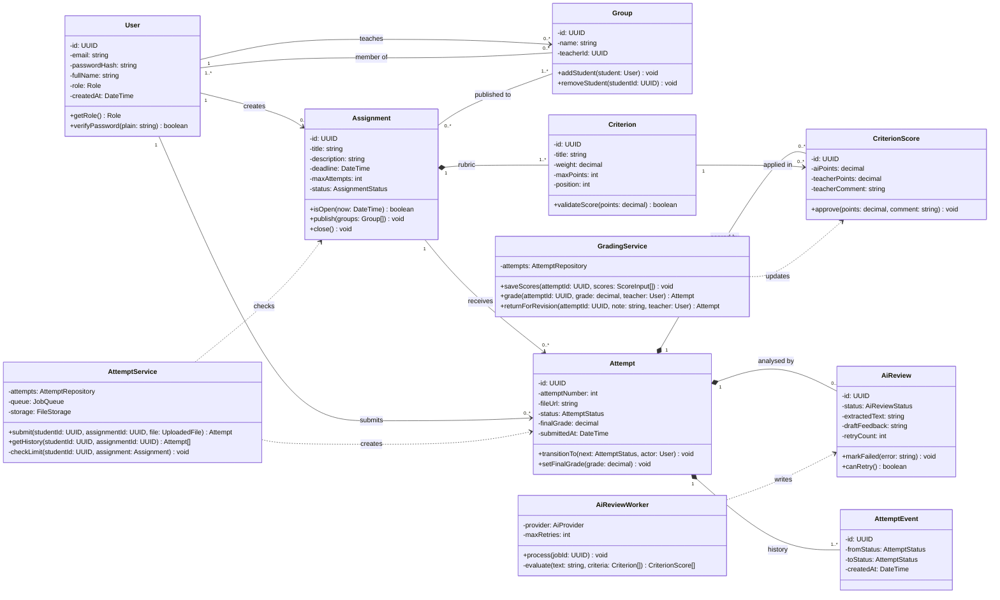

# UML Class Diagram

**Visibility:** `+` public, `-` private. **Multiplicity:** `1` exactly one, `0..1` zero or one, `0..*` zero or more, `1..*` one or more. **Relationships:** `-->` association, `*--` composition (the part cannot exist without the whole), `..>` dependency (a service uses a class). Entities match the database schema in `docs/database-schema.md`.

All entity attributes are private (`-`) and changed only through public methods, so rules such as valid status transitions and score limits are enforced in one place.