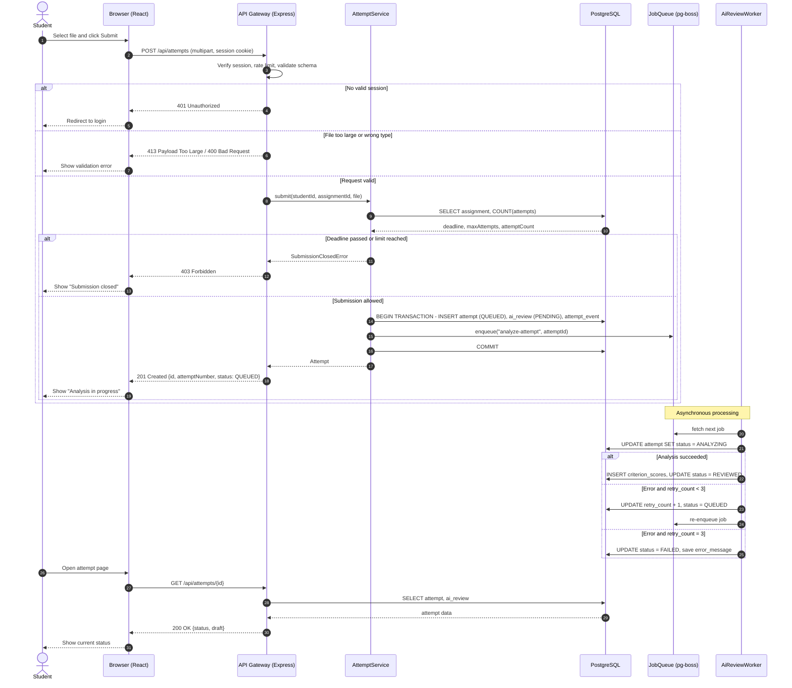

# UML Sequence Diagram — Submit Attempt (POST /api/attempts)

Messages are numbered in chronological order. Solid arrows are requests, dashed arrows are responses. `alt / else` blocks show the error paths.

The attempt, its AI review and the queue job are created in one database transaction (pg-boss uses the same PostgreSQL), so a job is never queued for an attempt that was not saved.